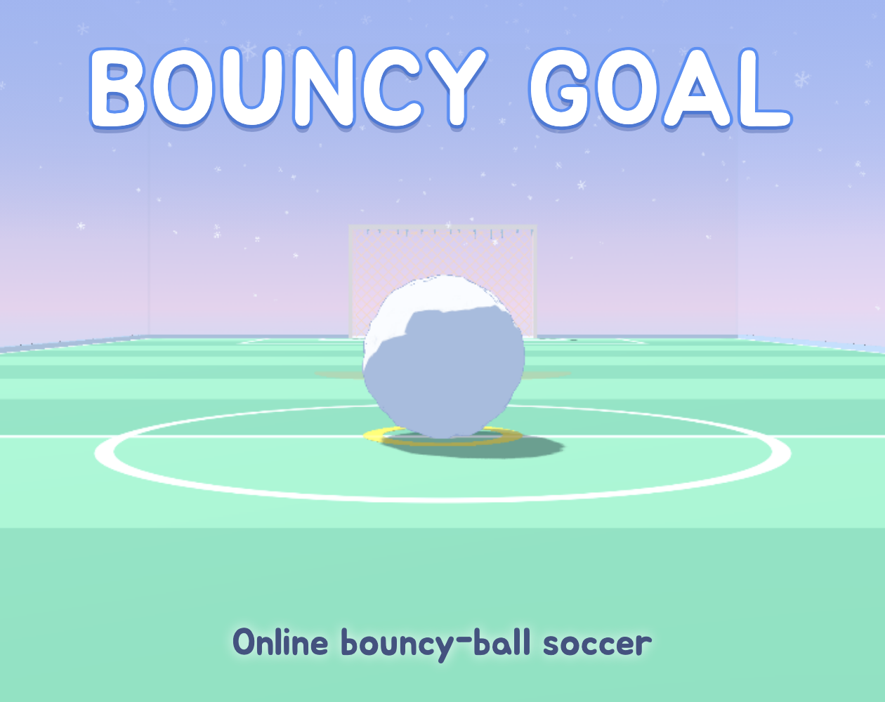

# Bouncy Goal (탱탱볼 튀기기)

## 제작 배경

- 추석에 수박게임을 하던 중 탱탱볼로 만들 수 있는 게임을 떠올리다,
- 오버워치의 루시우볼에서 영감을 받았습니다.

## 게임 방법

### 목표

상대방의 골대에 골을 넣어야 합니다.

### 조작 방법

- WASD 키로 캐릭터를 움직입니다.
- 마우스 좌클릭으로 공을 찹니다.

### 종료 조건

경기 시간이 지나면 종료됩니다.

## 제작 과정

TDD 방법론으로 개발했습니다.

상세 과정은 [블로그](https://blog.jisu-bong.com/dev/?tag=bouncy-goal)를 참고해 주세요.
